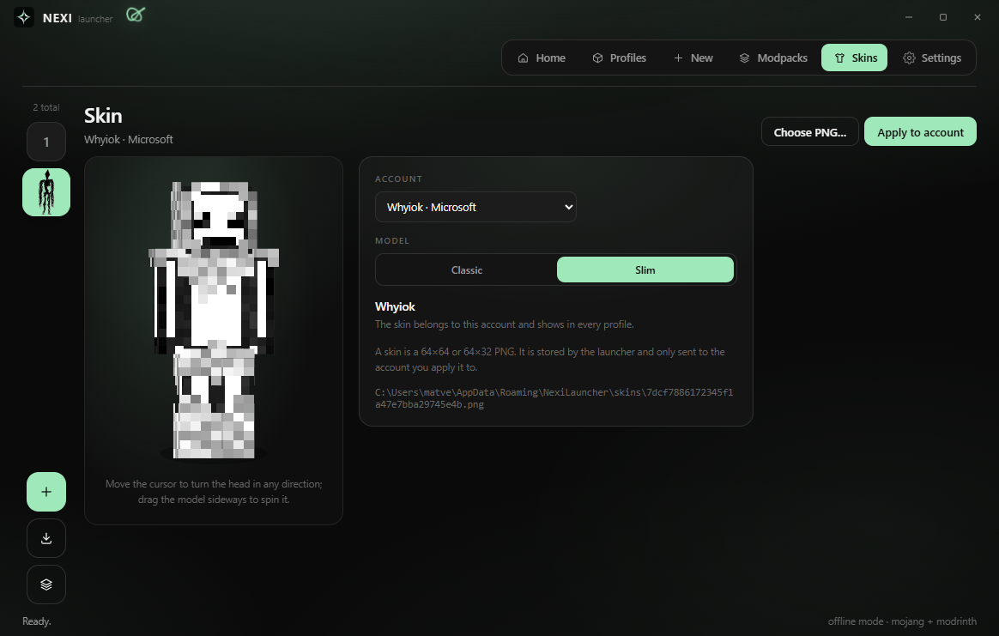
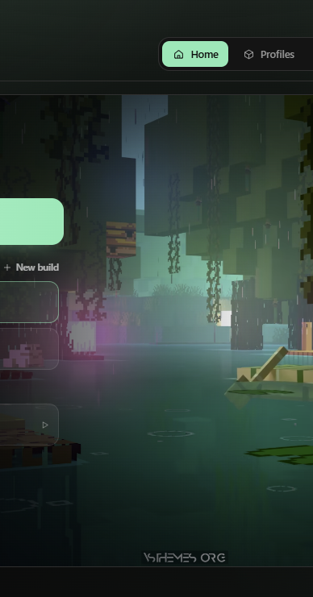
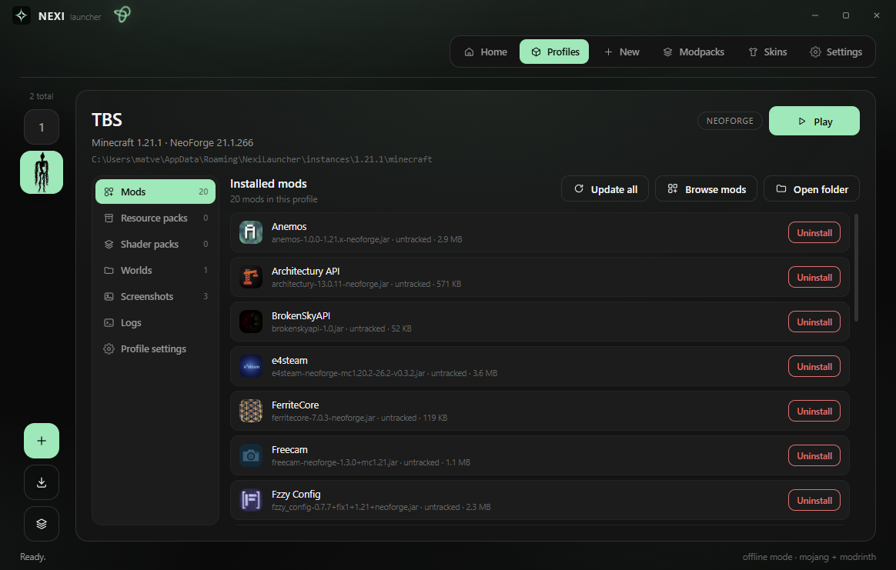

# Nexi Launcher

A lightweight custom Minecraft launcher for Windows. The backend is Python,
the interface is plain HTML/CSS/JS rendered with
[pywebview](https://pywebview.flowrl.com/) (Edge WebView2), and the release
build is a single `Nexi-Portable.exe` produced by PyInstaller.

> Unofficial project. Not affiliated with Mojang, Microsoft or Modrinth.
> You still need to own a copy of Minecraft to play online.

## Download

[**Download the latest release →**](https://github.com/Whyiok/nexi-launcher/releases/latest)

Get `Nexi-Portable.exe` from the Releases page and run it — no Python
installation is needed. If you prefer an installed copy, download `NexiLauncher-Setup.exe`
instead: it installs per user into `%LOCALAPPDATA%\Programs\Nexi Launcher`,
adds Start Menu and (optionally) desktop shortcuts plus an entry in Windows
Settings → Apps, and never asks for administrator rights. Windows 10/11 x64
and the Microsoft Edge WebView2 Runtime are required (Windows 11 includes it).

## Screenshots

| Main menu | Skins | Builds |
| :---: | :---: | :---: |
| [](docs/screenshots/home.png) | [](docs/screenshots/skins.png) | [](docs/screenshots/builds.png) |

## Features

- **Isolated profiles** (Prism-style): each profile has its own game directory
  under `%APPDATA%\NexiLauncher\instances\<slug>\minecraft`, while the Mojang
  versions, libraries and assets are shared. Nothing is copied or migrated from
  an existing `.minecraft`. Several profiles can run at the same time, each
  with its own Play / Stop / Restart controls.
- **Version management**: releases, snapshots, old betas and old alphas with
  filter chips; change the Minecraft version, the mod loader or the loader
  build of an existing profile without recreating it.
- **Loaders**: Fabric, Forge and NeoForge installed from their official
  installers.
- **Mods**: Modrinth browser with explicit Minecraft-version and mod-loader
  filters that do not follow the selected profile, infinite scroll (pages are
  prefetched before you reach the bottom), multi-select batch install,
  per-profile browser state, installed mod names and icons resolved from
  Modrinth or straight from the jar files (works offline). Mod updates live in
  the profile pane, not in the browser.
- **Resource packs, shaders and modpacks**: packs work on vanilla profiles;
  mods require a loader. Modpacks have their own page in the top bar, and
  `.mrpack`, CurseForge `.zip` and plain archives can be imported as new
  profiles.
- **Accounts**: Microsoft (device-code OAuth), Ely.by (Yggdrasil password or
  OAuth2 + PKCE) and offline accounts, kept as a list you can reorder and
  switch between. Each profile can also pin its own account in Profile
  settings; profiles left on the default use the active account.
- **Automatic Java**: the Mojang runtime matching the selected version is
  reused or downloaded on demand.
- **Profile tools**: duplicate, worlds backup, file verification, custom icon,
  a live Minecraft log viewer (`logs/latest.log` of the selected profile),
  worlds and screenshots panes, Play / Stop / Restart. The screenshots pane
  shows live thumbnails, refreshes itself while it is open, previews a
  screenshot in a lightbox and copies it to the clipboard.
- **Skins**: a 3D preview that turns left and right, the classic/slim model
  toggle, a built-in default skin, and a PNG chooser. The skin page has its own
  account picker; offline accounts are greyed out. The chosen skin is applied
  to the picked Microsoft account, while an Ely.by account shows the skin its
  website currently serves and links to
  [ely.by/skins](https://ely.by/skins) for changes (Ely.by exposes no upload API
  — the game loads the skin through authlib-injector).
- **Themes and languages**: three accent palettes picked in Settings — Mint
  (default), Soft orange and Indigo — recolour the buttons, highlights and
  glows. A dark/light colour mode (dark by default) switches the whole
  interface between black and white surfaces, and the interface language can be
  set to English or Russian without a restart (the choice is remembered).
- **Home / main menu**: the first tab shows a slowly panning blocky panorama,
  the builds ordered by their last launch, the recently played worlds of every
  profile and one large Play button for the default build. Clicking a build
  makes it the default without leaving the page. The background can be
  replaced in Settings with a still image (PNG, JPG/JFIF, WebP, BMP, AVIF),
  an animated GIF or an MP4/WebM clip. On Minecraft 1.20+ a
  world can be started straight into the game (Quick Play).
- **Custom window chrome**: the native frame is replaced by a title bar drawn
  by the page — the NEXI logo and name, minimize / maximize / close buttons,
  double-click to maximize, and native edge resizing.
- **Launcher log**: the launcher's own rotating diagnostic log is shown in
  Settings, with buttons to open the file or its folder.

## Requirements

- Windows 10 or 11 (x64)
- Microsoft Edge WebView2 Runtime (preinstalled on Windows 11; otherwise
  install the Evergreen runtime from Microsoft)
- Python 3.11+ to run from source (`tomllib` is used)

## Run from source

```powershell
python -m venv .venv
.venv\Scripts\Activate.ps1
pip install -r requirements.txt
python launcher.py
```

## Build the executable

```powershell
pip install -r requirements-dev.txt
.\build.ps1
```

or manually:

```powershell
python -m PyInstaller "build/Nexi Launcher.spec" `
    --distpath _dist --workpath _build_tmp --noconfirm
```

The script builds two variants of the same launcher:

- `_dist\Nexi-Portable.exe` — one file, no console window, for the portable
  download;
- `_dist\NexiLauncher\NexiLauncher.exe` — a folder build that loads its
  runtime files from `_internal` next to the exe, packaged as
  `_dist\NexiLauncher.zip` and used by the installer. Installed copies update
  from that zip.

If a signing certificate is configured (see `sign.ps1`), both executables are
signed before packaging.

### Build the installer

```powershell
.\build_installer.ps1
```

This rebuilds the folder build, then packs it into `_dist\NexiLauncher-Setup.exe`
(also copied to the project root). The setup is a one-file PyInstaller
executable as well: it carries the launcher folder inside, and a copy of itself
becomes `Uninstall.exe` in the install folder. It installs per user, so no
administrator rights are needed, and it also accepts `--silent`,
`--silent-uninstall` and `--uninstall` on the command line.

## Project layout

```
launcher.py               entry point (`python launcher.py`; PyInstaller target)
nexi/
  config.py               paths, shared directories and constants
  logging_setup.py        rotating log, stream redirection, crash hooks
  util.py                 small shared helpers
  net.py                  HTTP downloads, Mojang CDN mirror, network probe
  modrinth.py             Modrinth search and dependency helpers
  versions.py             version JSON, classpath and launch arguments
  java_runtime.py         Mojang Java runtime download and Java discovery
  instances.py            isolated profiles: files, mods, packs, icons
  loaders.py              Fabric / Forge / NeoForge builds and installers
  vanilla.py              vanilla install and file verification
  modpacks.py             `.zip` / `.mrpack` import helpers
  media.py                loopback image/video server (previews, backgrounds)
  ms_auth.py              Microsoft OAuth and Minecraft services login
  ely_auth.py             Ely.by Yggdrasil, OAuth2 PKCE, authlib-injector
  skin_images.py          skin PNG handling and uploads
  app.py                  logging, window creation and the pywebview loop
  api/                    pywebview bridge, composed into `LauncherApi`
    base.py               bridge plumbing, settings and account storage
    profiles.py           profile selection, state and contents
    accounts.py           Microsoft and Ely.by account flows
    create.py             create / edit / import / verify profiles
    mods.py               mod install, update and uninstall
    content.py            content browser (mods, packs, shaders, worlds)
    loaders.py            loader installation endpoint
    skins.py              skin preview, picker and upload
    diagnostics.py        launcher and network log panels
    home.py               main menu data: recently played worlds
    background.py         GIF / MP4 / WebM Home background
    launch.py             game process lifecycle
    window.py             custom title bar window controls
webui/index.html          single-page UI
webui/style.css           design tokens and layout
webui/i18n.js             English/Russian interface dictionary and DOM translator
webui/app.js              UI logic, talks to Python via window.pywebview.api
build/Nexi Launcher.spec  single-file PyInstaller spec (bundles the webui folder)
build/Nexi App.spec       folder (onedir) spec used by the installer
build.ps1                 convenience build script for both variants
sign.ps1                  optional Authenticode signing for built executables
installer/installer.py    per-user setup and uninstaller (Tk UI, silent mode)
build_installer.ps1       builds both launcher variants and NexiLauncher-Setup.exe
```

Each module imports only what it needs; the bridge mixins are combined in
`nexi/api/__init__.py` as `class LauncherApi(BaseApi, ProfilesApi, ...)`, so
every public method is still exposed to the page exactly as before.

## Local data and privacy

Runtime files live in `%APPDATA%\NexiLauncher` (not next to the executable) and
are excluded from git:

- `settings.json` — preferences only: player, RAM, Java, theme, language;
- `accounts.json` — the account list and its tokens (Microsoft refresh token,
  Ely.by access/client/refresh tokens) plus the Ely.by OAuth client secret;
- `logs\launcher.log` — rotating diagnostic log;
- `skins\` — PNG skins picked in the Skins screen;
- `instances\` — every profile (its own mods, worlds, configs and game dir);
- `authlib-injector-*.jar` — downloaded automatically for Ely.by launches.

Older versions wrote the settings, logs, skins and profiles somewhere else
(next to the exe, or in `%APPDATA%\.minecraft\instances`). They are moved into
`%APPDATA%\NexiLauncher` automatically on the first start; the shared Mojang
files in `.minecraft` are left untouched.

Passwords and Ely.by OAuth secrets are never written to the log (the
corresponding API calls are excluded from tracing). Keep `accounts.json` and
`logs\` private — they can contain account tokens. Versions before 2026-11-15
kept the tokens inside `settings.json`; the launcher moves them into
`accounts.json` on the first start and scrubs the old file.

## Notes

- Modrinth requests are made directly from Python; on networks where
  `api.modrinth.com` is blocked the browser shows a clear error instead of
  hanging.
- The launcher is Windows-only: it relies on WinForms/WebView2 through
  pywebview. File and folder pickers use the native Win32 common dialogs, so
  the app does not spawn hidden PowerShell processes.

## License

[MIT](LICENSE) © 2026 Whyiok
